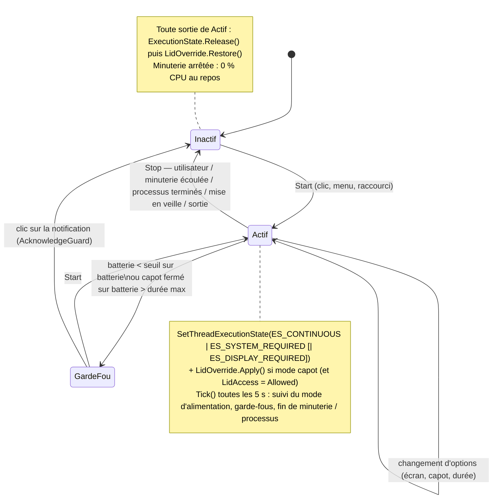

# Architecture

## Vue d'ensemble

```
KeepLid.sln
├── src/KeepLid.Core      net8.0 — logique pure, testable partout (aucune API Windows)
│   ├── Session/          AwakeController (machine à états), EndCondition, SessionTimer, ProcessWatcher,
│   │                     GuardRails, StatusText (textes de l'info-bulle)
│   ├── Power/            LidOverride (sauvegarde / écriture / restauration), RestoreRecord + FileRestoreStore
│   ├── Settings/         AppSettings + SettingsStore (settings.json), Hotkey
│   ├── Logging/          FileLog (log.txt, rotation 1 Mo)
│   ├── Abstractions/     IPowerSettings, IExecutionState, IPowerStatusProvider, IProcessProbe, IClock, ILog
│   └── Resources/        Strings.resx (EN, neutre) + Strings.fr.resx (FR) → classe Strings générée par MSBuild
├── src/KeepLid.App       net8.0-windows10.0.19041 — WPF + NotifyIcon (WinForms)
│   ├── Program.cs        point d'entrée : application normale OU « --watchdog <pid> <restore.json> <log> »
│   ├── App.xaml.cs       racine de composition, événements Windows → contrôleur
│   ├── Native/           DllImport (signatures vérifiées dans les en-têtes du Windows SDK 10.0.26100)
│   ├── Platform/         implémentations Windows des abstractions, fenêtre de messages (capot, mode
│   │                     d'alimentation, raccourci), StartupTask, licence Store, chien de garde
│   ├── Tray/             icône (4 états) et menu
│   └── Views/            Réglages, Accueil (3 étapes), Guide capot, Processus, Durée personnalisée
├── src/KeepLid.Package   Package.appxmanifest, Images/, KeepLid.Package.wapproj (Visual Studio)
├── tests/KeepLid.Core.Tests   xUnit (faux IPowerSettings, horloge simulée, crash simulé)
└── spike/                Phase 0 (faisabilité), conservé pour diagnostic
```

Principe : **toute décision est dans Core** (testée sans toucher au système) ; **App ne fait que relier** Windows
à Core. Tout s'exécute sur le thread UI (aucun verrou nécessaire), sauf `LidOverride` qui est verrouillé car il est
aussi appelé depuis les gestionnaires d'exceptions et par le processus chien de garde.

## Machine à états (`AwakeController`)



Icônes : Inactif = gris · Actif = bleu · Actif + capot appliqué = bleu + badge vert · GardeFou = orange « ! ».

## Accès au réglage du capot (option a+ du spike)

Au démarrage, `LidOverride.ProbeAccess()` réécrit **la valeur déjà en place** (aucun changement effectif) :

| Résultat | Comportement |
|---|---|
| `Allowed` | case « Continuer quand le capot est fermé » : écriture / restauration automatiques |
| `Denied` (`ERROR_ACCESS_DENIED`) | entrée « Capot fermé : guide de réglage… » ; aucune écriture ; rappel à la fin de session si l'action est restée « Ne rien faire » |
| `NoLid` (`GetPwrCapabilities.LidPresent = 0`) | entrée grisée |

Le garde-fou « capot fermé sur batterie » s'applique dans tous les cas où le PC tourne capot fermé
(notification `GUID_LIDSWITCH_STATE_CHANGE`), que le réglage ait été changé par KeepLid ou par l'utilisateur.

## Mécanisme de restauration

Invariant : **`restore.json` existe ⇔ une valeur système peut différer de celle de l'utilisateur.**
Il est écrit (fichier temporaire + `Flush(true)` + déplacement atomique) **avant** toute écriture, et supprimé
**après** une restauration réussie.

```mermaid
sequenceDiagram
    participant U as Utilisateur
    participant A as AwakeController
    participant L as LidOverride
    participant F as restore.json
    participant W as Windows (powrprof)
    participant D as Chien de garde
    U->>A: active le mode capot
    A->>L: Apply(includeBattery)
    L->>W: PowerGetActiveScheme + PowerRead{AC,DC}ValueIndex
    L->>F: Save {schéma, AC/DC d'origine, valeur appliquée=0}
    L->>W: PowerWrite{AC[,DC]}ValueIndex(0) + PowerSetActiveScheme
    A-->>D: démarre « KeepLid.exe --watchdog <pid> <restore.json réel> <log réel> »
    Note over A,W: … tâche en cours, capot fermé …
    U->>A: désactive / quitte / fin de session / veille / exception
    A->>L: Restore()
    L->>W: relit ; réécrit l'origine SEULEMENT si la valeur est encore 0
    L->>F: Delete
    D->>F: (toutes les 2 s) fichier absent → le chien de garde se termine
```

Déclencheurs de restauration :

| Événement | Où |
|---|---|
| Désactivation, minuterie écoulée, processus terminés, garde-fou | `AwakeController.Stop` |
| Quitter | `App.Quit` → `Cleanup` |
| Fermeture de session / arrêt | `Application.SessionEnding` |
| Mise en veille / reprise | `SystemEvents.PowerModeChanged` (Suspend → Stop ; Resume → Restore) |
| Exception non gérée | `DispatcherUnhandledException`, `AppDomain.UnhandledException` |
| App tuée (Gestionnaire des tâches, plantage natif) | processus chien de garde (`Platform/Watchdog.cs`) |
| Coupure de courant, les deux processus tués | au **lancement suivant** (`App.OnStartup` → `Restore()`) |
| Changement de mode d'alimentation pendant l'activité | `FollowActiveScheme` : restaure l'ancien, sauvegarde et applique au nouveau |
| Manuel | Réglages › « Restaurer les réglages d'alimentation d'origine maintenant » |

Règles de sûreté :

* l'utilisateur a changé le réglage entre-temps (valeur ≠ 0) → sa valeur est conservée ;
* le mode d'alimentation sauvegardé a été supprimé (`ERROR_FILE_NOT_FOUND`) → rien à restaurer ;
* `restore.json` illisible → renommé `restore.corrupt.json` (diagnostic), notification, commande `powercfg` indiquée dans la FAQ ;
* écriture refusée pendant la restauration → `restore.json` conservé pour une nouvelle tentative.

## Données locales

`%LOCALAPPDATA%\KeepLid\` — en MSIX, Windows redirige ce dossier vers
`%LOCALAPPDATA%\Packages\<PFN>\LocalCache\Local\KeepLid\` (même chemin vu par l'app et son chien de garde,
supprimé à la désinstallation) : `settings.json`, `restore.json` (temporaire), `log.txt` + `log.1.txt`.
Aucune écriture dans le registre ; « Lancer au démarrage » utilise l'extension MSIX `windows.startupTask`.

## Ressources et langue

L'interface suit `CultureInfo.CurrentUICulture` (langue d'affichage de Windows) : `fr-*` → français, sinon anglais.
Les deux `.resx` doivent garder les mêmes clés et les mêmes `{0}` : vérifié par `ResourceParityTests`.
